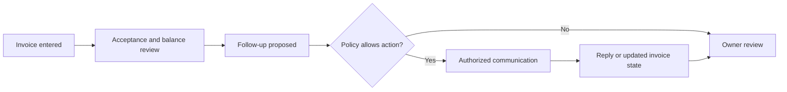

# FOLLOWTHROUGH | AI Invoice Follow-Up Product Case Study

**Product ownership · Business systems · AI-assisted workflows**

> This is an employer-facing portfolio case study, not the production code. All example names, figures, and messages are fictional. Implementation claims do not imply verified live integrations or customers.

## The problem
Small B2B teams need a way to organize overdue invoice follow-up and resolve customer approval bottlenecks with less manual effort.

## Product approach
FOLLOWTHROUGH explores a workspace for invoices, approval evidence, follow-up communication, exception handling, and owner review. The product concept emphasizes clear controls over autonomous messaging.

## My contributions
I led product scoping, prioritization, workflow and user-story design, acceptance criteria, and iterative troubleshooting, using AI-assisted development tools to help implement the application. I do not claim sole authorship of AI-generated code.

## Product decisions
- Track invoice **acceptance** separately from **payment**.
- Pause or escalate ambiguous emails, disputes, and changed recipient details.
- Keep an auditable activity trail and explicit owner controls.
- Avoid claiming that a customer payment email proves payment occurred.
- Gate automated sending on authorization, connection readiness, and policy settings.

## Conceptual workflow

## Case-study contents
- [Architecture overview](architecture/OVERVIEW.md)
- [Representative user stories](product/USER-STORIES.md)
- [Product decisions](product/DECISIONS.md)
- [Fictional demo](product/SYNTHETIC-DEMO.md)
- [Publication and security limitations](security/PUBLICATION-REVIEW.md)

## Technical context
The private source contains web application code, server-side integration logic, invoice workflows, tests, and scheduling components. Mocked tests and code presence do not verify production behavior, provider activation, reliability, or actual customer adoption.

**Website:** https://followthroughfinance.com (the site's current functionality is not independently verified here).

## Why the code is private
The full production repository remains private to protect proprietary implementation details, security configuration, and operational information. This repository is independent and contains portfolio documentation only.
