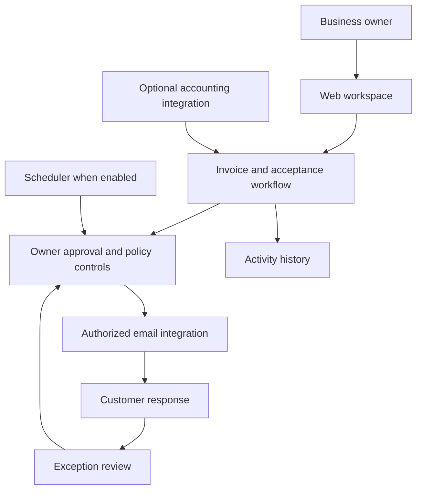

# Conceptual architecture

This is a deliberately high-level design, **not a validated production topology**. It intentionally excludes database schema, endpoints, security implementation, credentials, and proprietary agent prompts.
